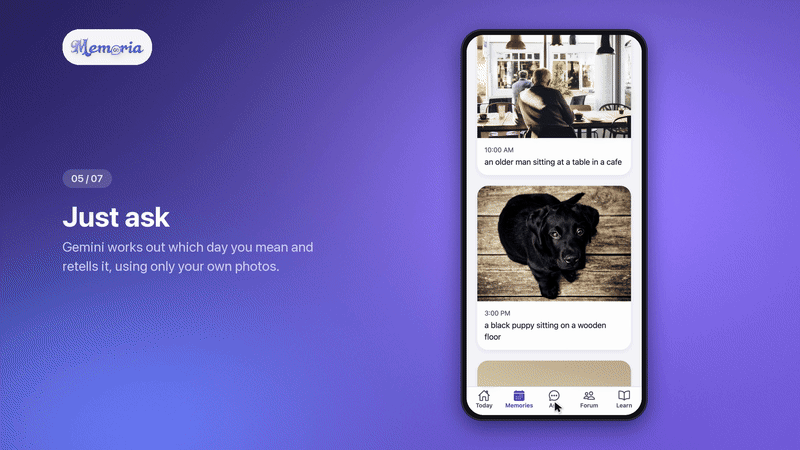
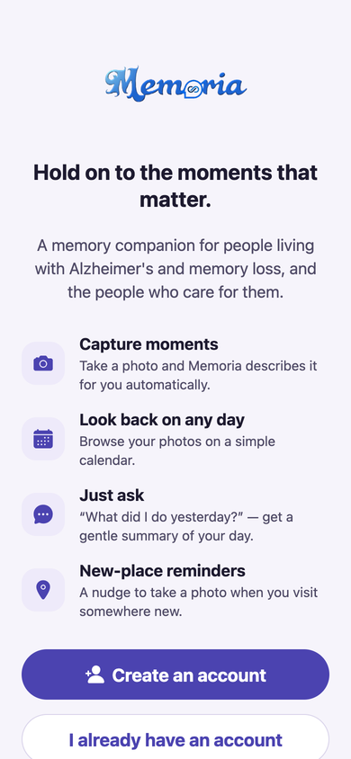
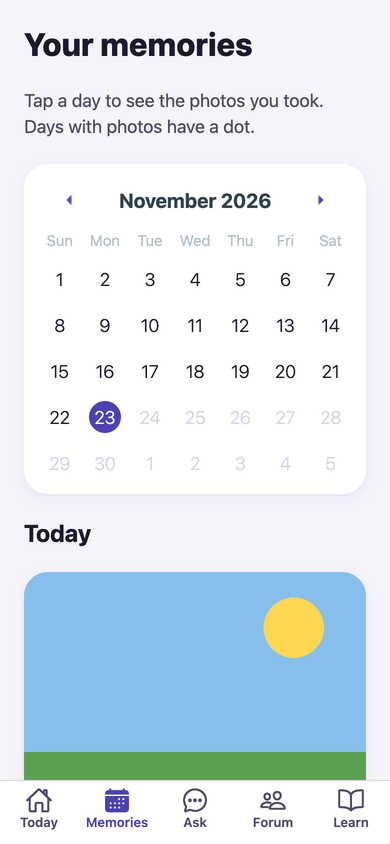
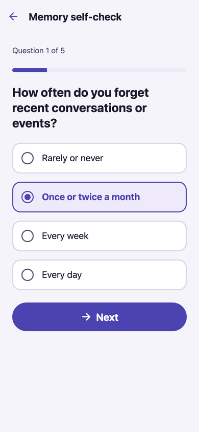
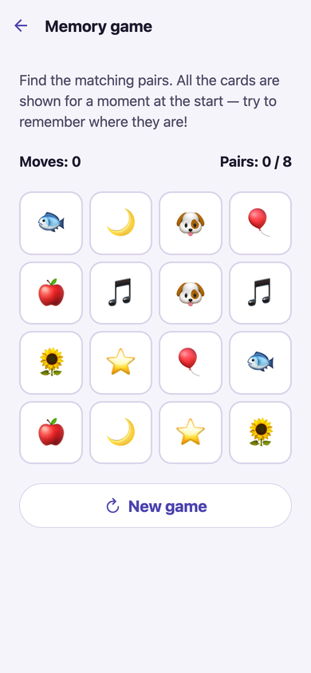
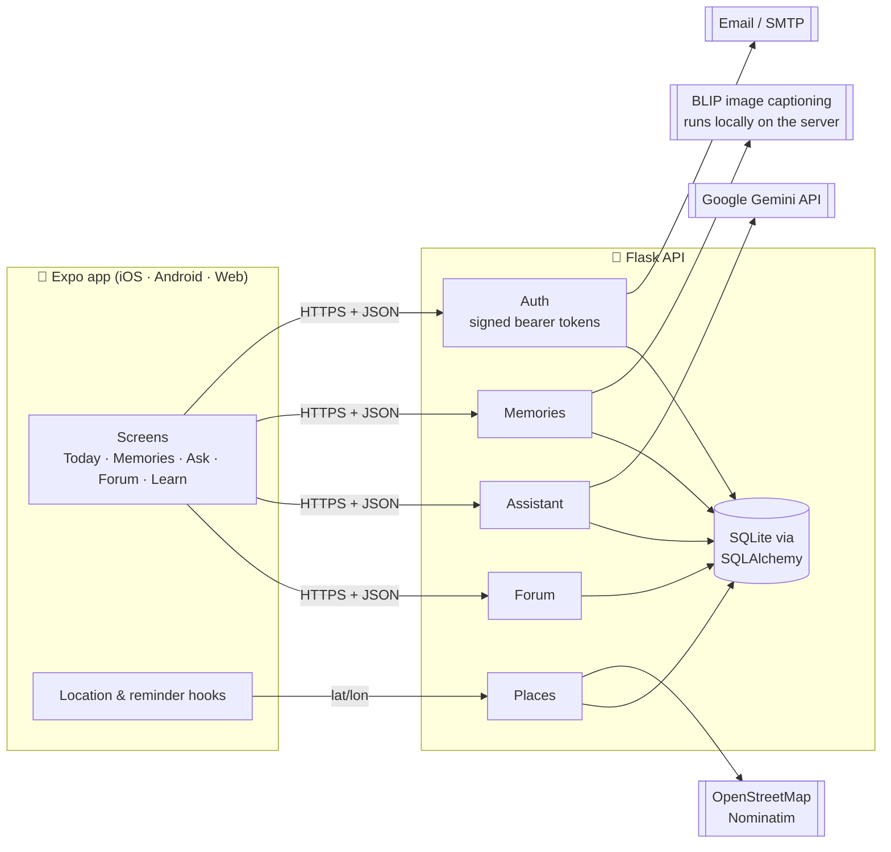

<p align="center">
  
</p>

<p align="center">
  <strong>A memory companion for people living with Alzheimer's disease, and the people who care for them.</strong><br/>
  Capture moments as photos, let AI describe them, and ask <em>“What did I do yesterday?”</em> whenever you need a reminder.
</p>

<p align="center">
  
  
  
  
  
  
</p>

---

## Demo

<p align="center">
  <a href="docs/demo/memoria-demo.mp4">
    
  </a>
</p>

<p align="center">
  ▶️ <a href="https://youtu.be/pQj4Kg5lDa4"><strong>Watch the full 1:40 walkthrough</strong></a>: capturing moments, the memory calendar, Ask Memoria, the community forum and the memory game.
</p>

## Why Memoria?

More than 55 million people worldwide live with dementia, and Alzheimer's disease is the most common cause. One of its earliest and most painful symptoms is losing track of recent events: what you did this morning, who visited yesterday, where you went last weekend.

Memoria turns a phone into an external memory. People take photos throughout the day. An image-captioning model describes each photo, and Memoria files it under that day. Later, the person (or their caregiver) can browse any day on a calendar or simply **ask in plain language** and get a gentle, easy-to-read summary built only from their own photos.

Memoria was built at **CNLC 2024** by [Yajat Mittal](https://github.com/YajatMittal), [Ilyaas Ait Simmou](https://github.com/IlyaasAitSimmou) and [Aarnav Shah](https://github.com/aarnavshah12).

## Features

| | Feature | What it does |
|---|---|---|
| 📸 | **Capture a moment** | Take or choose a photo. The backend captions it automatically with **Salesforce BLIP** and saves it to the user's *local* day. |
| 🗓️ | **Memory calendar** | Days with photos are marked on a calendar. Tap a day to see that day's photos and captions; share or delete any of them. |
| 💬 | **Ask Memoria** | A chat assistant powered by **Google Gemini**. It works out which day you mean (“yesterday”, “last Saturday”, “March 3rd”), pulls that day's photos, and retells the day in short, warm sentences. It's prompted never to invent details that aren't in the photos. |
| 📍 | **New-place nudges** | While the app is open, it notices when you arrive somewhere you haven't been before and suggests taking a photo to remember the visit. |
| ⏰ | **Daily reminder** | A gentle 7 PM notification: *“How was your day? Take a photo of something from today.”* |
| 👥 | **Community forum** | Posts and replies for patients, families and caregivers to share tips and support. |
| 🧠 | **Learn & exercise** | Plain-language information about Alzheimer's, trusted resources, a 5-question memory self-check (clearly labelled *not* a diagnosis), and a card-matching memory game. |

### Designed for its users

Memoria's users are often older adults with memory loss, so accessibility drove the UI:

- **Large type** (18 pt body, 32 pt titles), **high-contrast** colours (WCAG AA+) and **56 pt touch targets**.
- One clear action per card, consistent placement, and no time pressure. Errors are shown inline in plain language (*“That code isn't right. Please check your email and try again.”*) instead of technical messages.
- Screen-reader labels and roles on every interactive element.
- The assistant's system prompt asks for short sentences and simple words, never makes the user feel bad for repeating a question, and points to a doctor or caregiver for health concerns.

## Screenshots

<p align="center">
  
  
  
  
</p>

## How it works



**Capturing a memory:** the app uploads the photo along with the user's local date. The server fixes EXIF rotation, strips metadata (including GPS), downsizes the image to at most 1600 px, and captions it with BLIP. The model loads lazily on the first upload, so the server starts instantly.

**Asking about a day** is a two-step pipeline:

1. **Understand.** Gemini runs with a JSON response schema and works out whether the message refers to a specific day, resolving relative dates against the user's local “today”.
2. **Answer.** If it does, the server loads that day's photos for *that user only*. If there are none, Memoria says so without calling the model. Otherwise Gemini summarizes the captions in the second person. General messages go to the same model as a friendly companion, with recent chat history for context.

**Security & privacy**

- The Gemini key **never ships in the app**. All AI calls go through the backend.
- Every data endpoint requires a signed, expiring bearer token and is scoped to the logged-in user, so nobody can read or delete another person's photos.
- Email verification codes are generated with `secrets`, expire after 10 minutes, are compared in constant time, and lock after 5 wrong attempts.
- Login errors don't reveal whether an email is registered.
- Tokens are stored in the iOS Keychain / Android Keystore via `expo-secure-store`.

## Tech stack

| Layer | Technologies |
|---|---|
| Mobile & web app | React Native 0.76, Expo SDK 52, Expo Router (file-based navigation), TypeScript (strict), react-native-calendars, expo-image-picker / location / notifications / secure-store |
| Backend | Python 3.10+, Flask 3 (app factory + blueprints), Flask-SQLAlchemy, itsdangerous tokens, Pillow |
| AI | Salesforce BLIP (`transformers` + PyTorch) for captions · Google Gemini (`google-genai`) for date understanding and summaries |
| Services | OpenStreetMap Nominatim (reverse geocoding), SMTP (verification email) |
| Testing | pytest (API tests with AI and network calls mocked) |

## Project structure

```
Memoria/
├── backend/                     Flask API
│   ├── memoria/
│   │   ├── __init__.py          App factory, error handlers, blueprint registration
│   │   ├── config.py            All settings, read from environment variables
│   │   ├── models.py            Account, Memory, Place, ForumPost, ForumComment
│   │   ├── auth.py              Token issuing + @login_required
│   │   ├── routes/              auth · memories · assistant · places · forum
│   │   └── services/            captioning (BLIP) · gemini · assistant · geocoding · email
│   ├── tests/                   pytest suite
│   ├── run.py                   Dev server entry point
│   ├── requirements.txt
│   └── .env.example
├── frontend/                    Expo app
│   ├── app/                     Routes (Expo Router)
│   │   ├── (auth)/              welcome · login · signup · verify/[accountId]
│   │   ├── (tabs)/              Today · Memories · Ask · Forum · Learn
│   │   ├── community/[postId]   Forum thread
│   │   ├── self-check.tsx, memory-game.tsx, about.tsx
│   │   └── _layout.tsx          Providers, splash screen, navigation stack
│   ├── src/
│   │   ├── api/                 Typed API client
│   │   ├── components/          Design-system components (Button, Card, TextField, …)
│   │   ├── context/             AuthContext (session restore, secure storage)
│   │   ├── hooks/               Daily reminder + new-place nudges
│   │   ├── utils/               Dates, cross-platform confirm dialog
│   │   └── theme.ts             Colours, type scale, spacing
│   └── .env.example
└── docs/screenshots/
```

## Getting started

### Prerequisites

- **Python 3.10+** and **Node.js 18+**
- A free **Gemini API key** from [Google AI Studio](https://aistudio.google.com/apikey)
- The **Expo Go** app on your phone, or an iOS simulator / Android emulator (the web build also works for most features)

### 1. Backend

```bash
cd backend
python -m venv .venv
source .venv/bin/activate            # Windows: .venv\Scripts\activate

# Optional: a much smaller CPU-only PyTorch build
pip install torch --index-url https://download.pytorch.org/whl/cpu

pip install -r requirements.txt
cp .env.example .env                 # then fill in SECRET_KEY and GEMINI_API_KEY
python run.py                        # http://localhost:5001
```

The first photo upload downloads the BLIP model (~1 GB) from Hugging Face. Later uploads use the cached model.

> **No email setup needed for local development.** If `SMTP_USER`/`SMTP_PASSWORD` are blank, verification codes are printed in the backend console.

### 2. App

```bash
cd frontend
npm install
cp .env.example .env                 # set EXPO_PUBLIC_API_URL
npx expo start                       # press i (iOS), a (Android) or w (web), or scan the QR code with Expo Go
```

When using **Expo Go on a physical phone**, `EXPO_PUBLIC_API_URL` must use your computer's LAN IP address (e.g. `http://192.168.1.20:5001`), not `localhost`. The phone and the computer must be on the same Wi-Fi network.

## Configuration

Backend settings (`backend/.env`):

| Variable | Required | Description |
|---|---|---|
| `SECRET_KEY` | ✅ | Long random string used to sign login tokens. |
| `GEMINI_API_KEY` | ✅ | Google Gemini key for the assistant. |
| `GEMINI_MODEL` | | Defaults to `gemini-flash-latest`. Set this to pin a specific model. |
| `SMTP_HOST`, `SMTP_PORT`, `SMTP_USER`, `SMTP_PASSWORD`, `MAIL_SENDER` | | Outgoing email for verification codes (for Gmail, use an [App Password](https://myaccount.google.com/apppasswords)). |
| `DATABASE_URL` | | SQLAlchemy URL. Defaults to SQLite at `backend/instance/memoria.db`. |
| `NOMINATIM_USER_AGENT` | | Identifies your deployment to OpenStreetMap, as their usage policy requires. |
| `CORS_ORIGINS`, `FLASK_DEBUG`, `PORT` | | Usual server settings. |

App settings (`frontend/.env`): only `EXPO_PUBLIC_API_URL`. Anything prefixed `EXPO_PUBLIC_` is bundled into the app and readable by anyone, so **secrets never go here**.

## API reference

All endpoints except signup, verification and login require an `Authorization: Bearer <token>` header. Errors always have the shape `{"error": "Human-readable message"}`.

| Method | Endpoint | Description |
|---|---|---|
| `POST` | `/auth/signup` | Create an account and email a 6-digit code → `{account_id}` |
| `POST` | `/auth/verify` | `{account_id, code}` → `{token, user}` |
| `POST` | `/auth/resend` | Send a new verification code |
| `POST` | `/auth/login` | `{email, password}` → `{token, user}` |
| `GET` | `/auth/me` | Current user |
| `POST` | `/memories` | Multipart `image` + `captured_on` (YYYY-MM-DD) → captioned memory |
| `GET` | `/memories?date=YYYY-MM-DD` | The user's memories for a day |
| `GET` | `/memories/days` | `{ "2025-02-18": 3, … }` (photo counts per day, for the calendar) |
| `DELETE` | `/memories/<id>` | Delete one of your memories |
| `POST` | `/assistant/chat` | `{message, today, history}` → `{reply, date, memories}` |
| `POST` | `/places/visit` | `{latitude, longitude}` → `{place, is_new}` |
| `GET` | `/places` | Places you've visited |
| `GET` / `POST` | `/forum/posts` | List / create posts |
| `GET` | `/forum/posts/<id>` | Post with its comments |
| `POST` | `/forum/posts/<id>/comments` | Reply to a post |

## Testing

```bash
cd backend
pip install -r requirements-dev.txt
pytest
```

The suite covers the full signup → verify → login flow, verification lockout, the rule that users can't access each other's data, uploads and validation, the assistant's date-recall and fallback paths, place de-duplication, and the forum. BLIP, Gemini, email and geocoding are mocked, so tests run offline in about 2 seconds.

For the app: `cd frontend && npm run typecheck`.

## Roadmap

- Store photos in object storage (e.g. S3) instead of the database, and move to Postgres for multi-user deployments
- Caregiver accounts linked to a patient, with shared calendars
- Voice input and text-to-speech for the assistant
- Background location using geofencing, with explicit opt-in
- Rate limiting on auth endpoints, and moderation tools for the forum

## Project history

Memoria began as a project for Canadian National Leadership Conference (CNLC) 2024. It was later refactored: secrets were moved out of the client, the backend was rebuilt as a modular Flask app with token auth and tests, and the app was redesigned around accessibility.

## Team

| | |
|---|---|
| **Yajat Mittal** | [@YajatMittal](https://github.com/YajatMittal) |
| **Ilyaas Ait Simmou** | [@IlyaasAitSimmou](https://github.com/IlyaasAitSimmou) |
| **Aarnav Shah** | [@aarnavshah12](https://github.com/aarnavshah12) |

## Disclaimer

Memoria is a supportive tool, **not a medical device**. The memory self-check is for reflection only and cannot diagnose Alzheimer's disease or any other condition. If you're worried about memory changes, please talk to a doctor.

## License

[MIT](LICENSE)
